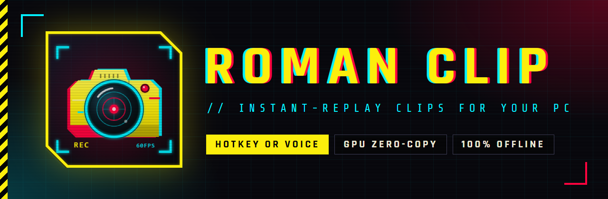
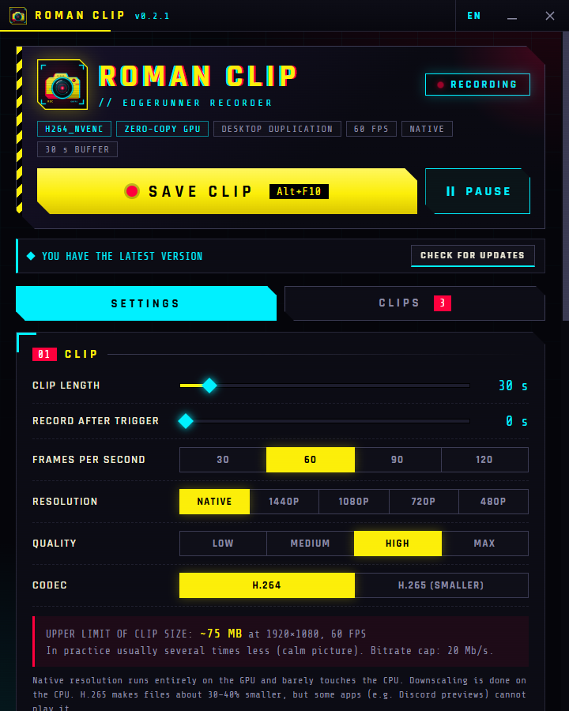
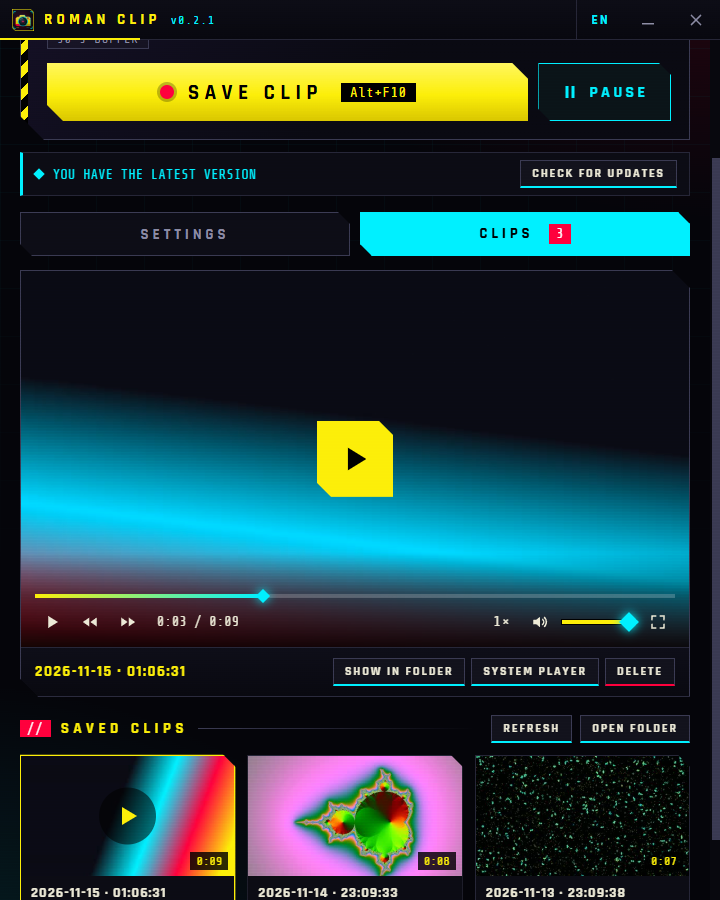
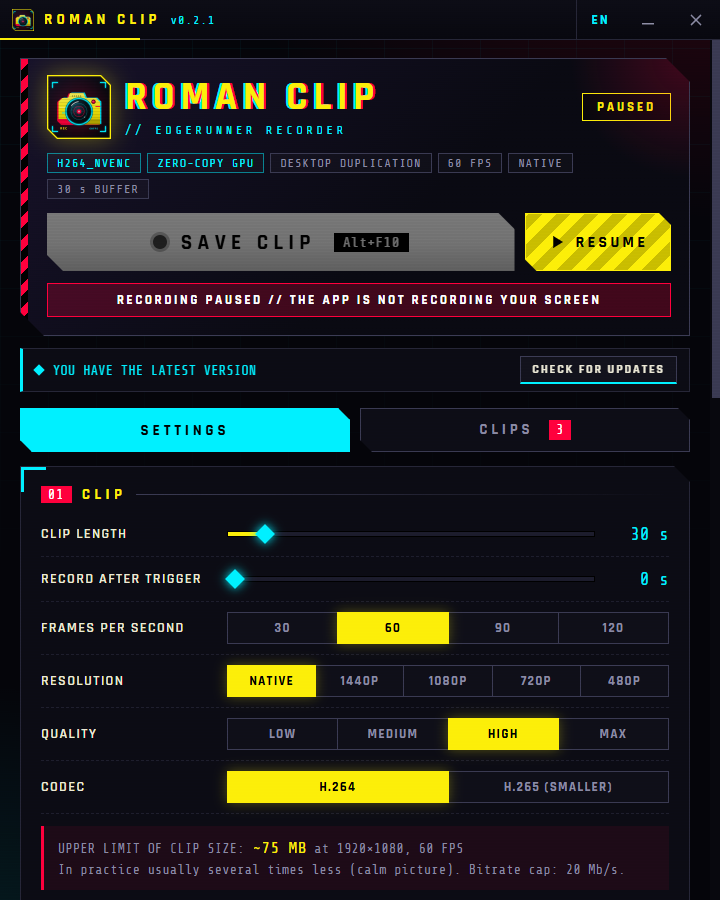
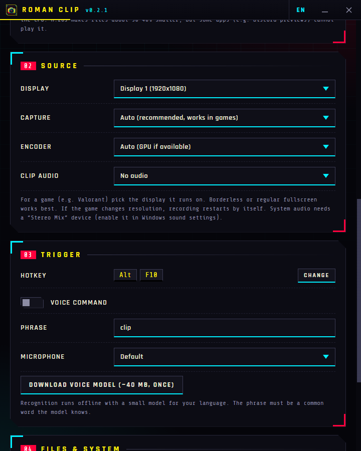

<p align="center">
  
</p>

<p align="center">
  <a href="https://github.com/Botipy/roman-clip/releases/latest"></a>
  
  
  <a href="LICENSE"></a>
</p>

<p align="center">
  <b>Instant-replay clips for Windows.</b> Roman Clip keeps the last seconds of your screen in a rolling buffer.<br>
  Press a hotkey or say a phrase and the moment is saved as an MP4, instantly and without re-encoding.<br>
  🇵🇱 <a href="#-polski">Wersja polska jest na dole</a>.
</p>

<p align="center">
  
</p>

---

## Features

- **Hotkey or voice.** `Alt+F10` by default, or say your own phrase. Voice recognition is offline (a small [Vosk](https://alphacephei.com/vosk/) model, downloaded once).
- **Instant save.** The buffer already holds encoded video, so saving a clip only glues segments together. No waiting, no re-encode.
- **Made for games.** Uses Windows Desktop Duplication. If a game changes resolution or display mode, recording restarts by itself.
- **Light on the machine.** On NVIDIA GPUs frames never leave the GPU (zero-copy). AMD uses the same path with an automatic fallback. ffmpeg runs at below-normal priority so the game keeps the CPU.
- **Small files.** Constant-quality encoding with a bitrate cap, and an optional H.265 mode that makes files roughly 30–40% smaller.
- **Clips panel with a built-in player.** Thumbnails, seeking, speed control, fullscreen, delete to the recycle bin.
- **Real pause.** One button stops recording completely, and the app says loudly that it is not recording.
- **English and Polish UI**, switchable in the title bar.
- **Auto-updates** from GitHub Releases, with the version and update status visible in the app.
- **Cyberpunk 2077 look**, because why not.

## Screenshots

<table>
  <tr>
    <td align="center"><br><sub>Settings and status HUD</sub></td>
    <td align="center"><br><sub>Clips panel with the built-in player</sub></td>
  </tr>
  <tr>
    <td align="center"><br><sub>Paused: the app is clearly not recording</sub></td>
    <td align="center"><br><sub>Source, hotkey and voice command</sub></td>
  </tr>
</table>

## Install

1. Open the **[Releases](https://github.com/Botipy/roman-clip/releases/latest)** page and download `Roman-Clip-Setup-x.y.z.exe`.
2. Run it. It installs for the current user without asking questions and starts right away.
3. Windows SmartScreen may warn because the installer is not code-signed: click **More info → Run anyway**.
4. Roman Clip lives in the system tray. Click its icon to open the window.

**Requirements:** Windows 10 or 11 (64-bit). A GPU with NVENC (NVIDIA), AMF (AMD) or Quick Sync (Intel) is recommended. Without one the app falls back to CPU encoding (x264). FFmpeg is bundled.

To uninstall use **Settings → Apps → Roman Clip**.

## Usage

| Action | How |
| --- | --- |
| Save a clip | Press the hotkey (`Alt+F10` by default), say your phrase, click **SAVE CLIP**, or use the tray menu |
| Stop recording | Click **PAUSE** (or the tray menu). The status turns red and shows **PAUSED** |
| Watch your clips | Open the **CLIPS** tab. Click a thumbnail to play it |
| Change language | The **EN / PL** button in the title bar, or **Files & system → Language** |
| Voice command | **Settings → Trigger → Voice command**, download the model once, then say the phrase (default: `clip`) |

Clips land in `Videos\Roman Clip` unless you pick another folder.

## Settings

| Option | What it does |
| --- | --- |
| Clip length | How many seconds back the clip reaches (5 to 300) |
| Record after trigger | Waits this many extra seconds before saving, so the clip also contains what happens right after |
| Frames per second | 30, 60, 90 or 120 |
| Resolution | Native, or scaled down to 1440p / 1080p / 720p / 480p (scaling runs on the CPU) |
| Quality | Low / Medium / High / Max. Sets the constant quality and the bitrate cap |
| Codec | H.264 (plays everywhere) or H.265 (smaller files, some apps cannot play it) |
| Display | Which monitor to record |
| Capture | Auto, Desktop Duplication (games) or GDI (compatibility, will not capture games) |
| Encoder | Auto, NVIDIA NVENC, AMD AMF, Intel QSV or CPU x264 |
| Clip audio | A microphone or a "Stereo Mix" device. Off by default |
| Hotkey | Click **CHANGE** and press the combination |
| Voice command | Phrase, microphone and the offline model |
| Clips folder, sound, notification, autostart | The usual |

The panel shows an estimate of the **maximum** clip size for the current settings. Real files are usually several times smaller.

## How it works

1. ffmpeg records the screen into one-second MPEG-TS segments in `%APPDATA%\Roman Clip\buffer` and deletes old ones, so the buffer never grows.
2. On a trigger the last *N* segments are concatenated with `-c copy` into an MP4. That is why saving is instant. Precision is about ±1 second.
3. If ffmpeg dies (a game switched resolution, the display changed), it is restarted and numbering continues. A clip only uses segments recorded since the last restart.
4. Voice recognition runs in a hidden window: microphone → Vosk (WebAssembly) → your phrase. It only does work while the microphone hears something.

Measured on one test PC (NVIDIA GPU, 1080p60, static desktop, so file sizes are optimistic):

| | CPU time per 10 s of recording |
| --- | --- |
| Frames copied from GPU to RAM | ~7.6 s |
| **Zero-copy (what Roman Clip does)** | **~0.7 s** |

## Updates

The app checks GitHub Releases shortly after start and every 6 hours. A newer version downloads in the background and installs when you quit. The current version and the update status are shown in the app. The tray menu has **Check for updates**.

## Build from source

```bash
git clone https://github.com/Botipy/roman-clip.git
cd roman-clip
npm install
npm start                          # run the app
npm run dist                       # build the installer into dist/
npx electron scripts/make-icon.js  # regenerate the icon from assets/icon.svg
npx electron scripts/make-docs.js  # regenerate the README images in docs/
```

To publish a release, bump `version` in `package.json`, then push a tag such as `v0.3.0`. The GitHub Actions workflow builds the installer and attaches it to the release.

## Troubleshooting

| Problem | Fix |
| --- | --- |
| SmartScreen warns on launch | The installer is not signed. Click **More info → Run anyway** |
| Black or empty clip from a game | Run the game in borderless or regular fullscreen, pick the display the game runs on, keep **Capture** on *Auto* |
| Hotkey does nothing | Another program may own that shortcut. Pick a different one. Games running as administrator can swallow global hotkeys |
| Voice command never triggers | Download the model, pick the right microphone and use a common word as the phrase. There is a 5 second cooldown |
| No sound in clips | Choose a device under **Clip audio**. System sound needs "Stereo Mix" enabled in Windows sound settings |
| Clip will not play in the app | It is probably H.265 and the GPU cannot decode it in the app. Use **System player** or switch to H.264 |
| Update check fails with 404 | The repository is private or the release has no installer yet |

## Credits

- [FFmpeg](https://ffmpeg.org/) (bundled via [ffmpeg-static](https://github.com/eugeneware/ffmpeg-static), GPL build) does the capturing and encoding.
- [Vosk](https://alphacephei.com/vosk/) and [vosk-browser](https://github.com/ccoreilly/vosk-browser) power the offline voice command.
- [Electron](https://www.electronjs.org/) and [electron-builder](https://www.electron.build/).
- Fonts: [Rajdhani](https://fonts.google.com/specimen/Rajdhani) and [Share Tech Mono](https://fonts.google.com/specimen/Share+Tech+Mono), both under the SIL Open Font License.

The look is a fan tribute inspired by *Cyberpunk 2077* and *Cyberpunk: Edgerunners* (Roman is the kid with the camera). This project is not affiliated with or endorsed by CD PROJEKT RED or Studio Trigger.

## License

[MIT](LICENSE) © Botipy

---

<a id="-polski"></a>

# 🇵🇱 Polski

**Roman Clip** to program do klipowania ekranu na Windowsie w stylu „instant replay". Działa w zasobniku i cały czas trzyma w buforze ostatnie sekundy obrazu. Wciskasz skrót albo mówisz frazę, a ostatnie 5 do 300 sekund ląduje w pliku MP4, od razu i bez ponownego kodowania.

## Co potrafi

- **Skrót albo głos.** Domyślnie `Alt+F10`, albo własna fraza. Rozpoznawanie mowy działa offline (mały model [Vosk](https://alphacephei.com/vosk/), pobierany jeden raz).
- **Zapis od ręki.** Bufor zawiera już zakodowane wideo, więc zapis klipu to tylko sklejenie kawałków.
- **Pod gry.** Korzysta z Desktop Duplication. Gdy gra zmieni rozdzielczość lub tryb ekranu, nagrywanie samo się restartuje.
- **Lekki dla komputera.** Na kartach NVIDIA klatki w ogóle nie opuszczają GPU (zero-copy), a AMD korzysta z tej samej ścieżki z automatycznym awaryjnym wyjściem, a ffmpeg ma obniżony priorytet, żeby gra dostała procesor.
- **Małe pliki.** Stała jakość z limitem bitrate'u oraz opcjonalne H.265, które daje pliki mniejsze o ok. 30–40%.
- **Panel klipów z odtwarzaczem.** Miniatury, przewijanie, prędkość, pełny ekran, usuwanie do kosza.
- **Prawdziwa pauza.** Jeden przycisk całkiem zatrzymuje nagrywanie, a program wyraźnie pokazuje, że nie nagrywa.
- **Interfejs po angielsku i po polsku**, przełączany przyciskiem **EN / PL** na pasku tytułu.
- **Autoaktualizacje** z GitHub Releases. Wersja i status aktualizacji są widoczne w programie.
- **Wygląd z Cyberpunka 2077.**

## Instalacja

1. Wejdź w **[Releases](https://github.com/Botipy/roman-clip/releases/latest)** i pobierz `Roman-Clip-Setup-x.y.z.exe`.
2. Uruchom plik. Instaluje się bez pytań i od razu startuje.
3. Windows SmartScreen może ostrzec, bo instalator nie jest podpisany: **Więcej informacji → Uruchom mimo to**.
4. Program siedzi w zasobniku. Kliknij jego ikonę, żeby otworzyć okno.

**Wymagania:** Windows 10 lub 11 (64-bit). Zalecana karta z NVENC (NVIDIA), AMF (AMD) lub Quick Sync (Intel). Bez niej program koduje procesorem (x264). FFmpeg jest w komplecie. Odinstalowanie: **Ustawienia → Aplikacje → Roman Clip**.

## Obsługa

| Co | Jak |
| --- | --- |
| Zapisz klip | Skrót (domyślnie `Alt+F10`), fraza głosowa, przycisk **ZAPISZ KLIP** albo menu zasobnika |
| Zatrzymaj nagrywanie | Przycisk **PAUZA** (albo menu zasobnika). Status zmienia się na czerwony napis **WSTRZYMANY** |
| Obejrzyj klipy | Zakładka **KLIPY**, klik w miniaturę odtwarza klip |
| Zmień język | Przycisk **EN / PL** na pasku tytułu albo **Pliki i system → Język** |
| Komenda głosowa | **Ustawienia → Wywołanie → Komenda głosowa**, pobierz model (raz), potem mów frazę (domyślnie `klip`) |

Klipy trafiają do `Wideo\Roman Clip`, o ile nie wybierzesz innego folderu.

## Ustawienia

| Opcja | Działanie |
| --- | --- |
| Długość klipu | Ile sekund wstecz sięga klip (5 do 300) |
| Dogranie po wywołaniu | Czeka tyle sekund przed zapisem, żeby w klipie było też to, co dzieje się zaraz po |
| Klatki na sekundę | 30, 60, 90 lub 120 |
| Rozdzielczość | Natywna albo zmniejszona do 1440p / 1080p / 720p / 480p (skalowanie liczy procesor) |
| Jakość | Niska / Średnia / Wysoka / Max. Ustawia stałą jakość i limit bitrate'u |
| Kodek | H.264 (działa wszędzie) albo H.265 (mniejsze pliki, część programów go nie odtworzy) |
| Ekran | Który monitor nagrywać |
| Przechwytywanie | Auto, Desktop Duplication (gry) albo GDI (zgodność, nie łapie gier) |
| Enkoder | Auto, NVIDIA NVENC, AMD AMF, Intel QSV albo procesor x264 |
| Dźwięk w klipie | Mikrofon lub „Stereo Mix". Domyślnie wyłączony |
| Skrót | Kliknij **ZMIEŃ** i naciśnij kombinację |
| Komenda głosowa | Fraza, mikrofon i model offline |

Program pokazuje oszacowanie **maksymalnego** rozmiaru klipu dla bieżących ustawień. Prawdziwe pliki są zwykle kilka razy mniejsze.

## Jak to działa

1. ffmpeg zapisuje ekran w jednosekundowych kawałkach MPEG-TS w `%APPDATA%\Roman Clip\buffer` i kasuje stare, więc bufor nie rośnie.
2. Po wywołaniu ostatnie *N* kawałków jest sklejane przez `-c copy` w MP4. Dlatego zapis jest natychmiastowy. Dokładność to ok. ±1 sekunda.
3. Gdy ffmpeg padnie (gra zmieniła rozdzielczość, zmienił się ekran), startuje od nowa, a numeracja leci dalej. Klip korzysta tylko z kawałków nagranych po ostatnim restarcie.
4. Rozpoznawanie głosu działa w ukrytym oknie: mikrofon → Vosk (WebAssembly) → Twoja fraza. Pracuje tylko wtedy, gdy mikrofon coś słyszy.

Pomiar na jednym komputerze testowym (karta NVIDIA, 1080p60, statyczny pulpit, więc rozmiary plików są optymistyczne): kopiowanie klatek z GPU do RAM to ok. 7,6 s czasu procesora na 10 s nagrania, a zero-copy (to, co robi Roman Clip) to ok. 0,7 s.

## Aktualizacje

Program sprawdza GitHub Releases krótko po starcie i co 6 godzin. Nowa wersja pobiera się w tle i instaluje po zamknięciu programu. Aktualną wersję i status aktualizacji widać w oknie, a w menu zasobnika jest **Sprawdź aktualizacje**.

## Budowanie ze źródeł

```bash
git clone https://github.com/Botipy/roman-clip.git
cd roman-clip
npm install
npm start                          # uruchom program
npm run dist                       # zbuduj instalator do dist/
npx electron scripts/make-icon.js  # odtwórz ikonę z assets/icon.svg
npx electron scripts/make-docs.js  # odtwórz obrazki do README w docs/
```

Wydanie: podbij `version` w `package.json` i wypchnij tag, np. `v0.3.0`. Workflow GitHub Actions zbuduje instalator i doda go do wydania.

## Rozwiązywanie problemów

| Problem | Rozwiązanie |
| --- | --- |
| SmartScreen ostrzega przy uruchomieniu | Instalator nie jest podpisany. **Więcej informacji → Uruchom mimo to** |
| Czarny lub pusty klip z gry | Uruchom grę w trybie pełnoekranowym okienkowym lub zwykłym pełnym ekranie, wybierz ekran, na którym działa, i zostaw **Przechwytywanie** na *Auto* |
| Skrót nie reaguje | Inny program może go używać. Wybierz inny. Gry uruchomione jako administrator potrafią połykać globalne skróty |
| Komenda głosowa nie działa | Pobierz model, wybierz właściwy mikrofon i użyj zwykłego słowa jako frazy. Jest 5 sekund przerwy po każdym wywołaniu |
| Brak dźwięku w klipach | Wybierz urządzenie w **Dźwięk w klipie**. Dźwięk systemowy wymaga włączonego „Stereo Mix" w ustawieniach dźwięku Windowsa |
| Klip nie odtwarza się w programie | Pewnie jest w H.265, a karta graficzna nie dekoduje go w programie. Użyj **Odtwarzacza systemowego** albo przełącz na H.264 |
| Sprawdzanie aktualizacji kończy się błędem 404 | Repozytorium jest prywatne albo wydanie nie ma jeszcze instalatora |

## Podziękowania i licencja

FFmpeg (w komplecie przez [ffmpeg-static](https://github.com/eugeneware/ffmpeg-static), wersja GPL) nagrywa i koduje obraz. Rozpoznawanie mowy to [Vosk](https://alphacephei.com/vosk/) i [vosk-browser](https://github.com/ccoreilly/vosk-browser). Fonty Rajdhani i Share Tech Mono są na licencji SIL OFL.

Wygląd to fanowski hołd dla *Cyberpunka 2077* i *Cyberpunk: Edgerunners* (Roman to dzieciak z kamerą). Projekt nie jest powiązany z CD PROJEKT RED ani Studio Trigger i nie jest przez nie wspierany.

Licencja: [MIT](LICENSE) © Botipy
